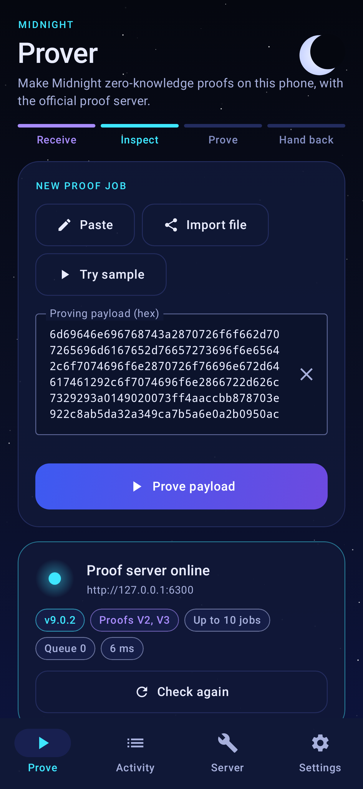
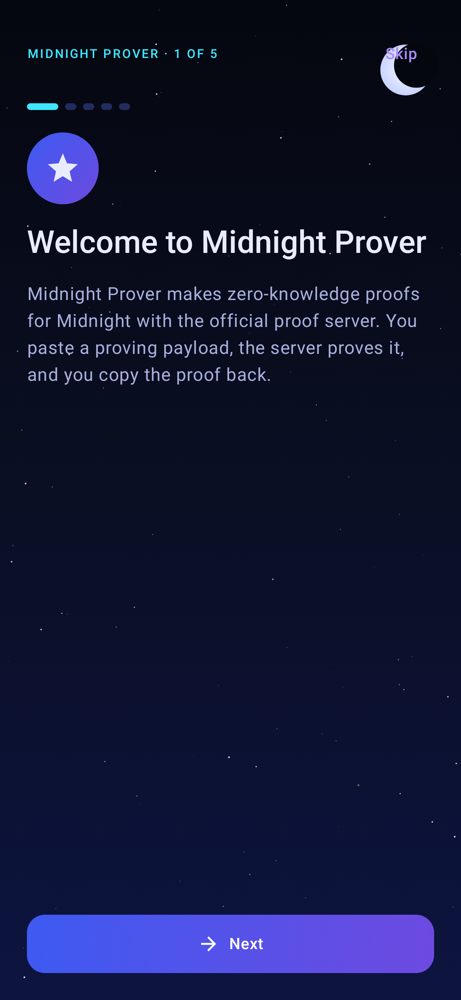
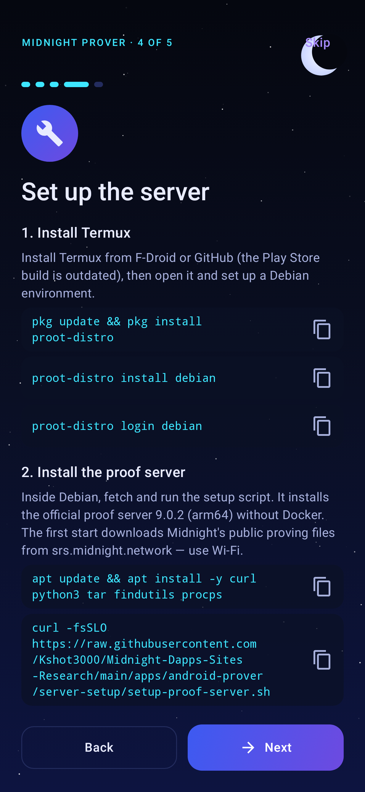
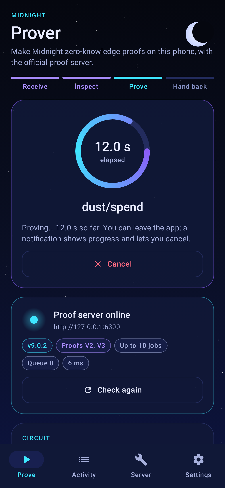
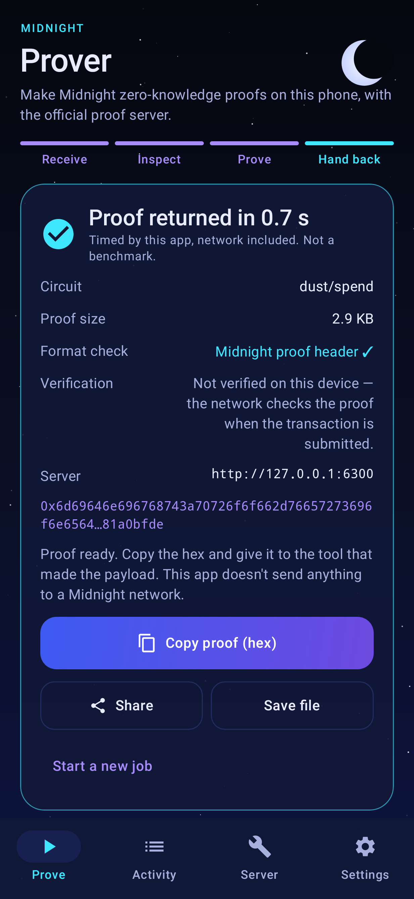
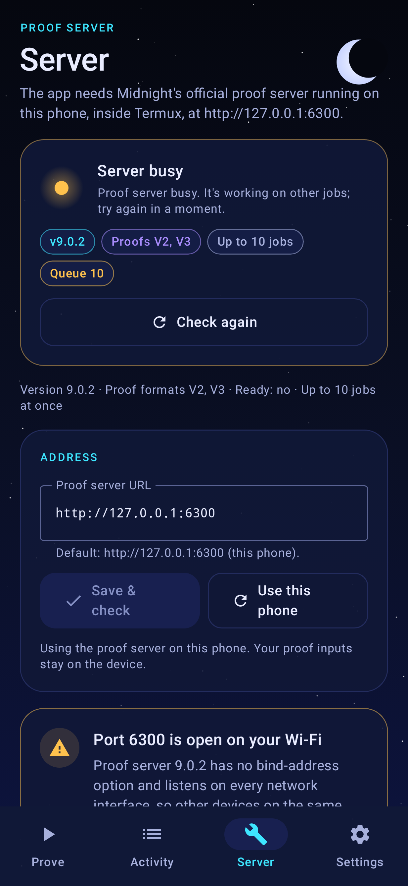
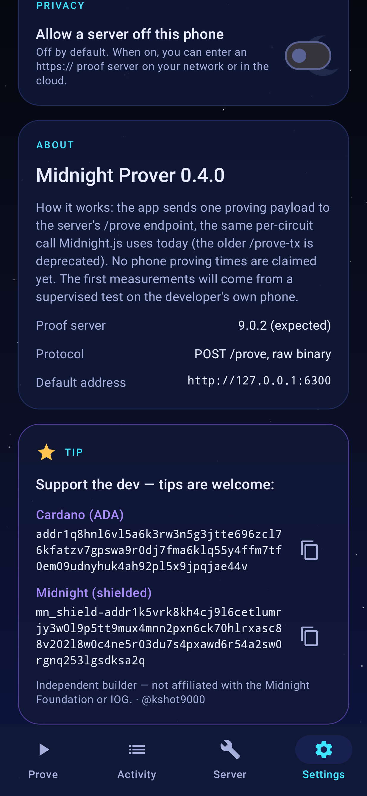

# Midnight Prover — Android app (v0.4.0)

An Android client for Midnight's official proof server. It sends one
proving payload at a time to the server and gets the proof back. The goal
is to run that server on the phone itself, inside Termux; that phone run
has not happened yet.



## Design — Route 3 (CLAUDE-AP-1 verdict)

The app does **not** reimplement the prover. It talks to Midnight's
official **midnight-proof-server 9.0.2** over its standard HTTP API:

- `GET /version` — expect `9.0.2`
- `GET /proof-versions` — `["V2", "V3"]`
- `GET /ready` — readiness + job capacity (`503` with `"status":"busy"` when the queue is full — shown as **busy**, not unreachable)
- `POST /prove` — prove one serialized proving payload (raw binary body)

**Protocol (v0.3, CLAUDE-AP-4).** Proving is per-circuit via `POST /prove`,
whose body is the raw serialized proving payload — a
`(proof-preimage-versioned, option(proving-data), option(fr-bls))` tuple,
exactly what Midnight.js and the wallet SDK send — and whose response is
raw proof bytes headed `midnight:proof-versioned:`. Midnight's own
local-proving guide marks `/prove-tx` "Deprecated. Midnight.js doesn't use
it." Muse's CLAUDE-AP-4 run proved a real 1,509-byte DUST-spend payload in
2.56 s (sandbox CPU, network not recorded). GROK-17 re-captured the same
kind of payload from the official hello-world flow on a local
`undeployed` devnet (not testnet, not mainnet) and ships it as the
**sample** and the test fixture (see *Verified* below).

The v1 deployment runs the official **arm64** proof-server build inside a
Linux environment on the phone (Termux + proot Debian), reached at
`http://127.0.0.1:6300`. The engine behind that interface is swappable.

## What the app does (v0.4.0, GROK-17)

- **First-run walkthrough** — what the app does, where the server runs,
  testnet only, the `server-setup/` commands with copy buttons, the
  phantom-process-killer warning, then a live **Connect** check.
- **Proof-job flow** — Receive → Inspect → Prove → Hand back:
  - *Receive*: paste, import a file, share hex/a file to the app, or load
    the bundled sample.
  - *Inspect*: the circuit read from the payload (e.g. `midnight/dust/spend`
    or `contract:…/storeMessage`), size, header check, whether the prover
    key travels with it. The circuit size **k is not in the payload**, so
    the app says so instead of guessing.
  - *Prove*: a foreground service with an ongoing notification (live
    timer + **Cancel**) keeps the request alive if you leave the app
    (Android 14/15 background limits). Cancel is honest: 9.0.2 keeps
    working on a job after the app disconnects.
  - *Hand back*: copy, share or save the proof (`.bin`). The app checks the
    proof header only — the network verifies the proof when the
    transaction is submitted.
- **Survives process death** — the job is persisted on every state change;
  if Android kills the app mid-proof, the next launch shows **Interrupted**
  with the payload kept and a one-tap retry. The editor draft lives in
  `SavedStateHandle`.
- **Server health** — `/version` + `/proof-versions` + `/ready` with
  retries and exponential backoff, a quiet refresh every 15 s while idle,
  and distinct states for online, busy, not ready, wrong version, offline
  and error. Every failure class (unreachable, timed out, queue full 429,
  busy 503, rejected 400 with the server's message, other HTTP, bad
  response, cancelled, interrupted) has its own message.
- **Privacy by default (P0-5)** — plain http is allowed **only to this
  phone** (`res/xml/network_security_config.xml`: 127.0.0.1 and
  localhost). A server off the phone needs an explicit opt-in in Settings,
  behind a warning that private proof inputs leave the phone, and must use
  https.
- **History** — the last 50 jobs, kept between launches, with three
  outcomes: PROVEN / FAILED / CANCELLED, and dates in the device's
  locale and 12/24-hour setting.
- **Design** — the Midnight theme (CLAUDE-AP-3, since v0.2): deep-space
  navy, indigo-to-violet gradient, cyan proof glow, starfield with a
  crescent moon; now with a dark launch theme + splash, an adaptive icon,
  Material 3 colour roles, and a navigation rail + two-pane layout on wide
  windows (an unfolded Z Fold-class screen). Settings: prove timeout
  (default 11 min, just above the server's 600 s job timeout), keep screen
  on, reduce motion, off-phone opt-in. About + **Tip**.
- **Accessibility** — every text colour ≥ 4.5:1 on its surface and input
  borders ≥ 3:1 (enforced by `PaletteContrastTest`), touch targets ≥ 48dp,
  TalkBack labels and live regions for status/progress/results, headings,
  font scaling up to 2× tested, and animations frozen under the system
  "Remove animations" setting, the in-app switch, and while proving.

## Screenshots

Rendered on the JVM by Robolectric + Roborazzi (`ScreenshotTest`), not on
an emulator or a phone. Server values in the "online" states and the
proof size/time on the result screen are the real values from GROK-17's
box run (9.0.2, `["V2", "V3"]`, capacity 10, 2,940-byte proof, 722 ms on
the box CPU — not a phone measurement).

| | | |
| --- | --- | --- |
|  |  |  |
|  |  |  |

All 22 are in [`docs/screenshots/`](docs/screenshots/), including the
unfolded (900 dp wide) layouts and a 1.6× font-scale render.

## Honest status

- **Not yet run on a phone.** No proving-time, thermal or battery numbers
  exist for on-device proving, and this app claims none. The first
  measurements will come from a supervised test on the developer's own
  phone (the Z Fold7).
- The proof server fetches the public proving parameters from
  `srs.midnight.network` on first boot (the k=10–15 files alone are about
  12.4 MB; the full download was not measured). Use Wi-Fi.
- Proof server 9.0.2 has **no bind-address option**: it listens on every
  interface, so devices on the same Wi-Fi can reach port 6300. Use trusted
  networks and stop the server when done.
- Testnet only: use payloads from Preview or Preprod (both testnets) or a
  local devnet. The app never signs anything and never sends anything to a
  Midnight network.

## Verified (GROK-17, on the build box — not a phone)

`LiveProofServerTest` drives the app's own `ProofServerClient` against a
real proof server 9.0.2 (amd64, Linux box), once via the official Docker
image and once via `server-setup/setup-proof-server.sh` (non-root
install):

| Check | Docker 9.0.2 | setup-script 9.0.2 |
| --- | --- | --- |
| `/version`, `/proof-versions`, `/ready` | 9.0.2, `["V2", "V3"]`, ok, capacity 10 | same |
| prove the 1,509-byte DUST fixture (2 runs) | 2,940-byte proof, header ok — 446 ms, 397 ms | 722 ms, 449 ms |
| garbage payload | 400 → **Rejected** with the server's message | same |

Client-side times on the box CPU, parameters already cached. They say
nothing about phone performance.

## Running the server on the phone

See [`server-setup/README.md`](server-setup/README.md): the official
arm64 proof server inside Termux/proot Debian — no Docker.

## Build and test

CI (`.github/workflows/android-prover.yml`) runs
`gradle testDebugUnitTest assembleDebug` and uploads the debug APK.
Locally: JDK 17, Gradle 8.9, compileSdk 35, targetSdk 35, minSdk 26.

```sh
gradle testDebugUnitTest assembleDebug lintDebug
# live check against a real proof server (skipped when unset):
PROOF_SERVER_URL=http://127.0.0.1:6300 gradle testDebugUnitTest --tests '*LiveProofServerTest*'
# re-render the screenshots:
gradle testDebugUnitTest -Proborazzi.test.record=true --tests '*ScreenshotTest*'
```

Robolectric tests pin `sdk=34` (`app/src/test/resources/robolectric.properties`)
so they run on JDK 17; the app itself targets SDK 35.

## Attribution

Built by @kshot9000. Support the dev — tips are welcome:
Cardano (ADA): addr1q8hnl6vl5a6k3rw3n5g3jtte696zcl76kfatzv7gpswa9r0dj7fma6klq55y4ffm7tf0em09udnyhuk4ah92pl5x9jpqjae44v
Midnight (shielded): mn_shield-addr1k5vrk8kh4cj9l6cetlumrjy3w0l9p5tt9mux4mnn2pxn6ck70hlrxasc88v202l8w0c4ne5r03du7s4pxawd6r54a2sw0rgnq253lgsdksa2q

Independent builder — not affiliated with the Midnight Foundation or IOG.
